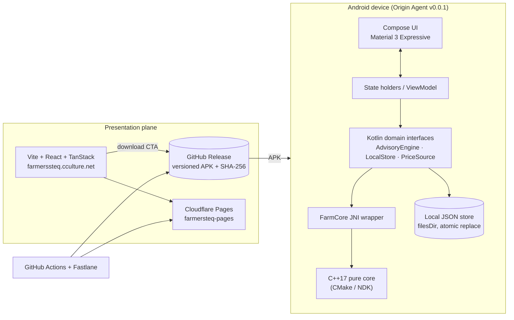

# ARCHITECTURE.md — Farmerssteq Global

## 1. System shape

## 2. Layering rules

1. **UI layer** (`ui/`) — Compose only. Knows design tokens and navigation; never touches files or JNI directly.
2. **State layer** (`MainViewModel`) — exposes immutable `UiState`, handles user intents, cancels nothing implicitly (scope is lifecycle-bound).
3. **Domain layer** (`domain/`) — small interfaces and models. Pure Kotlin where possible.
4. **Core layer** (`core/`, `cpp/`) — deterministic C++ functions with a one-file JNI bridge.
5. **Data layer** (`data/`) — implements `LocalStore` and `PriceSource`. Serialization is an implementation detail.

Arrows point inward. An inner layer never imports an outer one.

## 3. Key runtime flows

**Log a note (offline):** UI → intent → ViewModel → `LocalStore.save()` → atomic temp-file write + rename → Flow emits new list → UI recomposes.

**Get today's focus:** ViewModel loads notes → picks the most relevant one → calls `FarmCore.recommendation(stage, condition, days)` → C++ computes deterministic string → UI renders a calm, actionable card.

**Export:** ViewModel asks `LocalStore.snapshotJson()` → `ACTION_SEND` intent with `application/json` → user chooses destination.

## 4. Constrained-resource strategy

- No bitmaps; all illustrations are Compose vectors or CSS.
- No background services, no polling, no work manager in v0.0.1.
- JSON store is small and bounded; writes are atomic and debounced by explicit user action.
- Dynamic colour is opt-out; fallback palette has verified contrast.
- Compose content is stateless where practical to keep recomposition cheap.

## 5. Architecture Decision Records

**ADR-01 — Native Android first, not PWA.** *Decision:* Kotlin/Compose APK. *Why:* brief is explicit; native gives Material You, smooth micro-interactions, OS share sheet and offline reliability. *Consequence:* device-agnostic future is served by extracting shared logic, not by shipping a web wrapper.

**ADR-02 — C++ for the deterministic core, not for the UI.** *Decision:* pure C++17 rules functions behind one JNI file. *Why:* reusable on any future target, fast, testable, and satisfies the brief's C++ maximisation without making app maintenance miserable. *Consequence:* JNI surface kept tiny and versioned.

**ADR-03 — TanStack on the web plane.** *Decision:* TanStack Router + Query for the presentation/download site. *Why:* type-safe navigation and a clean pattern for a future release-manifest fetch; excellent ecosystem; no need for a heavyweight framework. *Consequence:* site stays static and cheap on Cloudflare Pages.

**ADR-04 — JSON file store instead of Room in v0.0.1.** *Decision:* atomic JSON via kotlinx.serialization. *Why:* zero KSP/annotation processing, fewer moving parts, easier audit, perfectly adequate for hundreds of notes. *Consequence:* `LocalStore` interface allows a Room implementation later without UI changes.

**ADR-05 — Fastlane + GitHub Actions for distribution.** *Decision:* Fastlane lanes mirrored by CI. *Why:* same behaviour locally and in automation; `set_github_release` handles artifacts. *Consequence:* Ruby only needed for release engineering, not for app builds.

**ADR-06 — Vector/wordmark-first identity.** *Decision:* no bitmap logo dependency in v0.0.1. *Why:* supplied image was not machine-readable; a vector mark scales, themes and survives brand refreshes. *Consequence:* official logo can be dropped into reserved asset slots with no layout changes.

## 6. Device-agnostic migration path (future, not v0.0.1)

| Step | Action |
| --- | --- |
| 1 | Move `domain/`, `data/` and pure Kotlin ViewModel logic into `:shared` KMP module. |
| 2 | Keep `cpp/` as the universal core consumed from Kotlin and (later) C++ desktop targets. |
| 3 | Add `desktop` target with Compose Multiplatform; reuse ViewModel + shared + core, re-theme for large screens. |
| 4 | Add adaptive navigation (list-detail) for tablets/laptops; phone layout remains the primary contract. |

Nothing in v0.0.1 hardcodes an Android-only API above the state layer except `Share` intent and dynamic colour, both behind small wrappers.

## 7. Interoperability & replaceability seams

- `LocalStore` → swap JSON for SQLite/Remote sync.
- `PriceSource` → swap bundled seed data for an API or a PDF bulletin ingest.
- `AdvisoryEngine` → swap C++ rules for a model-backed service without touching UI.
- `ReleaseManifest` (TanStack Query) → point at a different CDN without changing components.

## 8. Failure modes and responses

| Failure | Response |
| --- | --- |
| Corrupt local JSON | Move to `.corrupt` backup, start empty, show non-alarming notice. |
| Native library missing | Fallback advisory string computed in Kotlin; app still usable. |
| No network | Everything still works; Solutions market signals labelled as bundled. |
| CI secrets absent | Build still runs; release job is skipped with a clear log message. |
| Cloudflare deploy fails | Site remains available at the previous deployment (Pages atomic deploys). |
